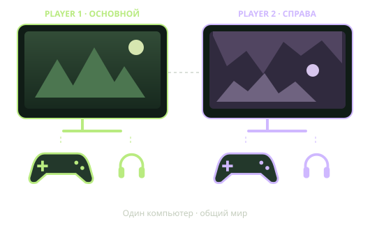

# Двое за одним компьютером

Два монитора, два независимых геймпада и отдельный звук в две пары наушников. Настройки Nucleus Co-op, переносимые дополнения и подробные инструкции.

## Выберите игру

| Игра | Полный самостоятельный гайд | Проверенный результат |
| --- | --- | --- |
| **Don't Starve Together** | **[Гайд DST](https://deathferre-cloud.github.io/nucleus-coop-configs/dst.html)** | Два клиента, русский язык, независимый ввод и звук, поверхность и пещеры |
| **V Rising** | **[Гайд V Rising](https://deathferre-cloud.github.io/nucleus-coop-configs/v-rising.html)** | Два игрока в одном частном мире, разные наушники, сохранение и загрузка обоих персонажей |

В каждом гайде есть всё для своей игры: программы, мониторы, reWASD, наушники, VoiceMeeter, установка, ежедневный запуск, сохранения и решение проблем. Общие шаги повторены, чтобы не собирать инструкцию по разным страницам. HTML работает локально из папки docs скачанного архива.

**[Главная и общая база](https://deathferre-cloud.github.io/nucleus-coop-configs/)** · **[Релиз v1.1.0](https://github.com/deathferre-cloud/nucleus-coop-configs/releases/tag/v1.1.0)** · **[История изменений](CHANGELOG.md)**



## Комплект v1.1.0

| Компонент | Версия / назначение |
| --- | --- |
| Nucleus Co-op | 2.4.2, отдельные экземпляры и раскладка окон |
| reWASD | 9.5.0.11346, два Steam Controller 2015 в два Xbox 360 |
| VoiceMeeter Potato | 3.0.2.8, целевые Shokz на MME |
| DesktopBridge | v5, проверен в DST и V Rising; в этом релизе общая DLL не менялась |
| DST | Патч Hub v15, русификаторы, отдельные данные |
| V Rising | Патч Hub v6 от Vlxst; игра v1.1.13.0-r99712-b17, build 23521359 |
| VRisingSettings | Сохранение JSON-массивов и отдельных настроек игроков через Newtonsoft.Json |

В архив входят исходники, патчи, примеры профилей, установка, диагностика, обезличенные снимки и гайды. Программы, игры, моды и лицензии берутся у разработчиков. Персональные ID, активация, сохранения и сырые логи не публикуются.

## Установка

Создайте свой профиль игры в интерфейсе Nucleus: два полных монитора, два разных XInput-контроллера, разные AudioInstance1/2. Файлы profile.reference.json содержат заглушки и не предназначены для импорта.

Скопируйте setup.example.json в setup.local.json, впишите свои пути и device ID. Для обычных XInput-контроллеров без reWASD можно задать `"controllerIds": []`. Закройте игры и Nucleus, скопируйте настройки и отдельно миры. Подробные шаги с нуля есть в каждом игровом гайде.

Для DST, официальный обработчик v15 и два скачанных мода Workshop:

```powershell
powershell -NoProfile -File ./tools/Install-DST.ps1 -Config ./setup.local.json
```

Для V Rising, официальный обработчик v6 и профиль Default/No!:

```powershell
powershell -NoProfile -File ./tools/Install-VRising.ps1 -Config ./setup.local.json
powershell -NoProfile -File ./tools/Link-VRisingWorlds.ps1 -Config ./setup.local.json
powershell -NoProfile -File ./tools/Link-VRisingWorlds.ps1 -Config ./setup.local.json -Apply
```

Первая команда ссылок показывает план, вторая создаёт адресные связи для двух служебных ID. Скрипт отказывается заменять обычные каталоги и перенаправлять известные реальные Steam-аккаунты. Автоматическое объединение существующих миров не выполняется. Условия и откат подробно описаны в гайде V Rising.

Запуск:

```powershell
powershell -NoProfile -File ./tools/Start-Coop.ps1 -Config ./setup.local.json
```

Для V Rising также есть games/v-rising/Start-VRising-Coop.cmd. Он использует конфигурацию в корне архива; затем выберите игру и профиль в Nucleus.

## Обязательные шаги V Rising

- **Сервер:** Player1 загружает частный мир. Player2: Играть → Сетевая игра → Показать все серверы → Прямое подключение → **127.0.0.1:9876**, **«LAN-сервер» выключен**. Адрес подходит только клиентам на одном ПК.
- **Звук:** в каждом окне самой игры: **Настройки → Звук → вниз до «Разное» → «Звуковая карта»**, затем свои наушники. В примере Player1: Headphones (2- OpenSwim Pro by Shokz), Player2: Headphones (OpenSwim Pro by Shokz). Реальные разные аудиосессии проверены после полного перезапуска.

## Горячие клавиши

| Клавиши | Действие |
| --- | --- |
| Ctrl+F10 | Скрыть/вернуть окна и освободить ввод |
| Ctrl+F7 | Второе окно: полный монитор ↔ 75% |
| Ctrl+F8 / Ctrl+F9 | Только скрыть / показать |
| Ctrl+E | Завершить сеанс после штатного выхода и сохранения |

Новый сеанс занимает оба монитора полностью. Скрытие не ставит игру на паузу. Сначала выходит в главное меню Player2, затем хозяин Player1; после сохранения можно завершать сеанс.

## Файлы и проверки

- docs/: выбор игры, два полных HTML-гайда и общая база.
- games/dst/ и games/v-rising/: патчи, профили-примеры, статусы, источники.
- common/: общие утилиты, профиль reWASD и [журнал находок](common/FINDINGS.md).
- tools/: установка, сборка, запуск, диагностика и резервные копии.
- tests/: регрессионная проверка настроек V Rising через настоящий Jint.
- snapshots/: обезличенные снимки. Точные личные копии храните отдельно.
- [VALIDATION.md](VALIDATION.md): проверки и их границы.
- [Находки V Rising](games/v-rising/FINDINGS.md): причины, неудачные подходы и исправления.

Рабочая игровая конфигурация проверена на исходном ПК. Переносимые скрипты отдельно проверены во временных каталогах под Windows PowerShell 5.1 и PowerShell 7, включая откат ошибок и сохранность данных junction. Игра на другом ПК требует собственной проверки. Bluetooth-переподключение на ходу и standalone server Yes! в V Rising не тестировались. В DST отдельно не проверялся переход персонажа в пещеру; подтверждены соединённые Master/Caves и игровой результат пользователя.

## Обновления и откат

Каждый релиз имеет CHANGELOG, тег Git и архив. До обновления копируйте настройки и полное дерево сохранений, включая пустые/скрытые папки. Адресные копии установщиков находятся в NucleusRoot/setup/backups, карта называется restore-map.json. Возвращайте связанные обработчик и помощники одной версии. Link-VRisingWorlds.ps1 -Undo удаляет только созданные им ссылки и оставляет целевые данные.

GPL-3.0-or-later. [Авторство и сторонние компоненты](THIRD-PARTY.md).
